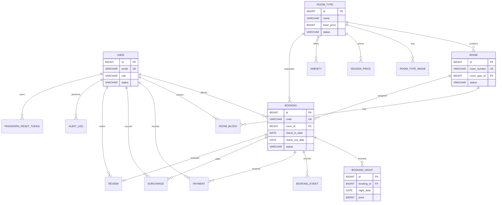

# StayBook entity relationship diagram

Khoảng ngày đặt phòng dùng nửa mở: hai booking chồng lấn khi
`a.checkIn < b.checkOut && b.checkIn < a.checkOut`; vì vậy trả ngày 8 và nhận ngày 8 là liền kề, không phải chồng lấn.
